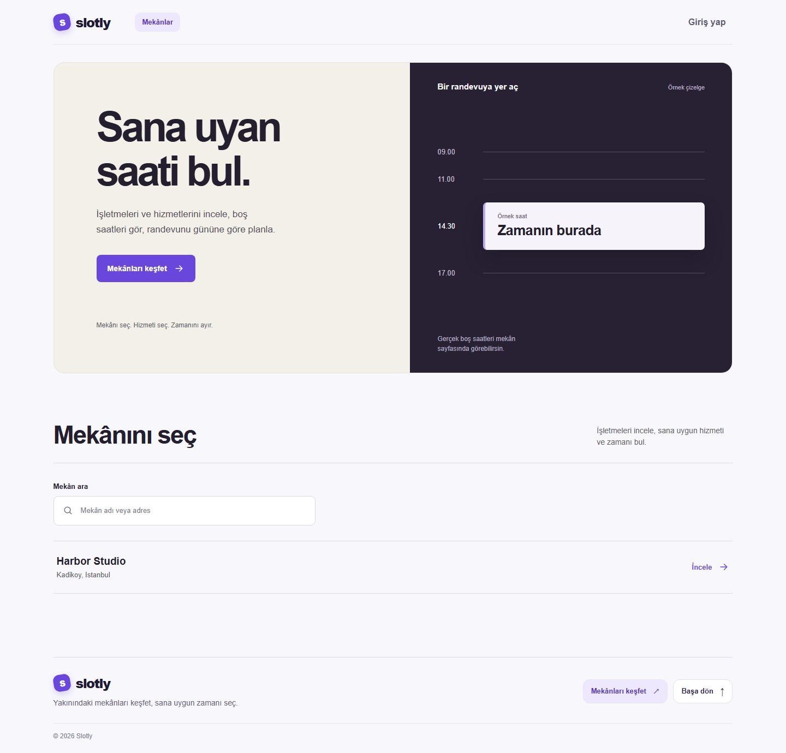
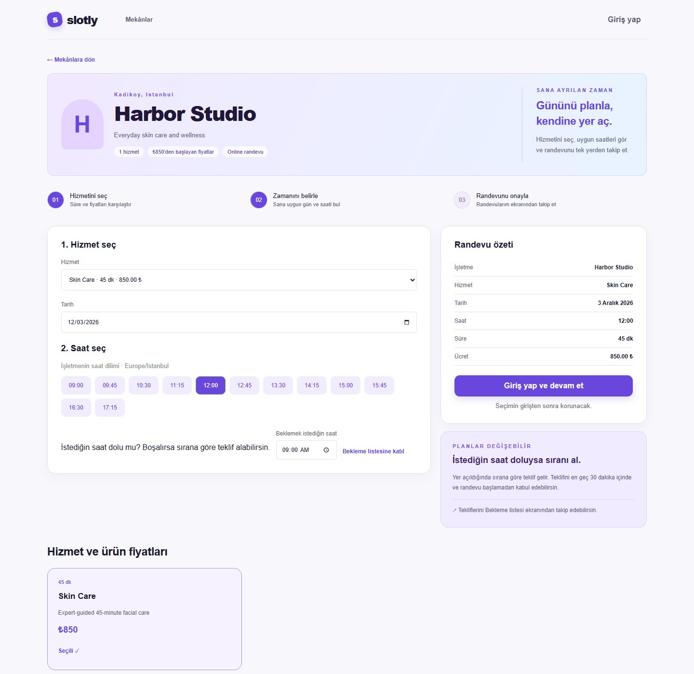
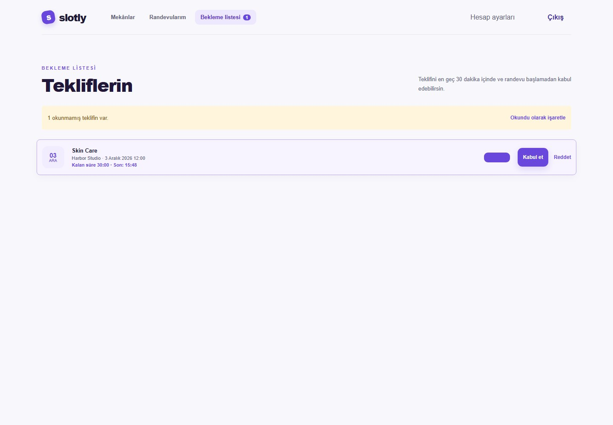

# Slotly

[](https://github.com/muhsinlight/Slotly/actions/workflows/ci.yml)
[](LICENSE)

Randevu ve otomatik bekleme listesi yönetimi. Müşteriler uygun saatleri bulup randevu alır; işletmeler hizmetlerini, çalışma saatlerini ve randevularını tek panelden yönetir.

Bir randevu iptal edildiğinde veya başka saate taşındığında boşalan saat, bekleme listesindeki sıradaki müşteriye uygulama içinde teklif edilir. Teklif en fazla 30 dakika geçerlidir ve en geç randevu başlangıcında sona erer. Teklif reddedilirse veya süresi dolarsa ayrılan yer serbest kalır.

## Özellikler

- Mekân ve hizmet keşfi, uygun saat seçimi, yaklaşan randevunun saatini değiştirme ve iptal.
- İlk gelenin önce teklif aldığı (FIFO) bekleme listesi, 1 koltukluk süreli teklif rezervi ve SSE ile anlık bildirimler.
- İşletmeler için hizmet/ürün, haftalık çalışma saati, özel gün/tatil istisnaları ve tamamlandı/gelmedi sonuç yönetimi.
- Doğrulanmış e-posta adresi, parola kurtarma, transactional outbox ve 2/24 saat randevu hatırlatma altyapısı.
- Yöneticiler için tüm işletmelerin randevu ve bekleme kayıtlarını gösteren salt okunur panel.

## Ekran görüntüleri

Görüntüler yerel demo ortamında örnek verilerle alındı; tarihler ve randevu saatleri güncel müsaitlik bilgisi değildir.







## Demo ve kapsam

Slotly, GitHub üzerinden incelenen ve yerelde çalıştırılan bir demo projesidir; barındırılan bir üretim ortamı veya canlı pilot planı yoktur. E-posta doğrulama, parola kurtarma, teklif ve hatırlatma akışları gönderimleri outbox'a kaydeder; e-posta sağlayıcısı bağlanmadığından gerçek e-posta teslimatı yapılmaz. Uygulama tek backend örneği varsayar; istek sınırları ve SSE bağlantıları süreç belleğinde tutulur. JWT tarayıcıda `localStorage` içinde saklanır. Ayrıntılar için [geliştirme ve pilot sınırlarına](docs/DEVELOPMENT.md) bakın.

## Teknolojiler

**Backend:** Java 25, Spring Boot, Spring Security, JPA, Flyway ve PostgreSQL 17.

**Frontend:** Vue 3, TypeScript, Vue Router, Temporal ve Vite (`pnpm`).

## Hızlı başlangıç

### Hazır demoyu Docker ile açın

Depo kökünde çalıştırın:

```sh
docker compose -f docs/docker/compose.demo.yaml --profile app up --build
```

Tarayıcıda [yerel demoyu açın](http://localhost:5174). Müşteri hesabı `demo-customer`, işletme sahibi hesabı `demo-owner`. İkisinin de demo parolası `SlotlyDemo2026!`.

**Boşalan bir saatin sıradaki müşteriye nasıl teklif edildiğini deneyin.**

1. `demo-customer` ile **Slotly Demo Stüdyo** içinde **Kısa bakım** hizmetini seçip gelecek bir gün için randevu alın. Stüdyonun kapasitesi bir kişi olduğu için seçtiğiniz saat dolar.
2. Gizli bir tarayıcı penceresinde ikinci bir müşteri hesabı oluşturup giriş yapın. Aynı mekân, hizmet ve tarih için ilk randevunun saatini girip **Bekleme listesine katıl** düğmesine basın.
3. İlk pencerede randevuyu iptal edin. İkinci pencerede bekleme listenizi açıp gelen teklifte **Kabul et** düğmesine basın. Yeni randevuyu ikinci hesabın randevuları arasında görebilirsiniz.

### Örnek verisiz Docker ortamı

Kendi işletmenizi oluşturarak başlamak için depo kökünde şu komutu çalıştırıp [yerel arayüzü açın](http://localhost:5173).

```sh
docker compose --profile app up --build
```

### Yerel geliştirme ortamı

JDK 25, Node.js 24+, pnpm 12, PostgreSQL 17 ve Git gerekir. Önce yerel PostgreSQL'de `slotly` veritabanını ve erişim kullanıcısını hazırlayın. Farklı bağlantı bilgileri için `DATABASE_URL`, `DATABASE_USERNAME` ve `DATABASE_PASSWORD` ortam değişkenlerini ayarlayın.

Kalıcı yerel bağlantı ayarlarını `backend/config/application-local.properties` dosyasında tutabilirsiniz. Bu dosya Git tarafından yok sayılır ve geliştirme komutu `local` profilini varsayılan olarak açar. Ardından depo kökünde:

```sh
node scripts/dev.mjs
```

Komut çalışan PostgreSQL bağlantı noktasını kontrol eder, gerektiğinde frontend bağımlılıklarını kurar ve API ile web arayüzünü çalıştırır. PostgreSQL'i veya Docker'ı başlatmaz.

RabbitMQ varsayılan olarak kapalıdır; normal geliştirme başlangıcında Docker gerekmez. RabbitMQ ile bildirim kuyruğunu denemek için `docker compose --profile messaging up -d --wait rabbitmq` komutunu çalıştırın ve API'yi `RABBITMQ_ENABLED=true` ortam değişkeniyle başlatın. RabbitMQ yönetim ekranı `http://localhost:15672` adresindedir (yerel kullanıcı/şifre: `slotly`). E-posta sağlayıcısı bağlı değilken e-posta işleri veritabanında bekler; yayınlama ve gönderim başlamaz.

- Web: http://localhost:5173 (demo profilinde: http://localhost:5174)
- API: http://localhost:8080 (demo profilinde: http://localhost:8082)
- Sağlık kontrolü: http://localhost:8080/actuator/health

Arayüzden işletme sahibi hesabı oluşturun; mekân, çalışma saatleri ve hizmet ekleyin. Randevu almak için müşteri hesabıyla giriş yapın. Hazır hesaplarla denemek için [ayrı demo ortamını](docs/SETUP.md#ayrı-demo-ortamı) kullanabilirsiniz.

İlk yönetici hesabını oluşturmak için API'yi başlatmadan önce `SLOTLY_ADMIN_USERNAME` ve en az 12 karakterli `SLOTLY_ADMIN_PASSWORD` ortam değişkenlerini ayarlayın. Uygulama hesabı yalnızca yoksa oluşturur; sonraki açılışlarda parolayı değiştirmez. Bu hesapla giriş yaptıktan sonra `/admin` paneli tüm işletmelerin randevu ve bekleme kayıtlarını gösterir. Açık kayıt formu yönetici rolünü kabul etmez.

`Ctrl+C` API ve arayüzü durdurur; yerel PostgreSQL kendi servisinde çalışmaya devam eder.

## Dokümantasyon

- [Kurulum, demo ve ortam değişkenleri](docs/SETUP.md)
- [API referansı ve alan kuralları](docs/API.md)
- [Hesap doğrulama ve parola kurtarma](docs/ACCOUNT.md)
- [E-posta bildirimleri ve outbox kuyruğu](docs/NOTIFICATIONS.md)
- [Randevu hatırlatmaları](docs/REMINDERS.md)
- [Testler, CI ve yedekleme](docs/DEVELOPMENT.md)
- [Yol haritası ve ürün kararları](docs/ROADMAP.md)

## Proje yapısı

```text
backend/       Tek Spring Boot uygulaması (Dockerfile dahil)
  src/main/java/com/slotly/api/
    common/    Ortak ayarlar, BaseEntity, AOP, güvenlik, yanıt ve hata yönetimi
    module/    user, auth, place, booking, waitlist ve notification alanları
  src/main/resources/  Ayarlar ve Flyway migration dosyaları
  src/test/    Backend birim, entegrasyon ve Postman testleri
frontend/      Vue 3 uygulaması, Dockerfile ve Playwright tarayıcı testleri
docs/          Kurulum, API, hesap, bildirim ve geliştirme rehberleri
  docker/      Ayrı demo ve test Compose ortamları
scripts/       Geliştirme, test ve Git kancası araçları
.github/       CI iş akışları
```

`compose.yaml` konteyner veritabanını, isteğe bağlı `app` profiliyle API/arayüz konteynerlerini ve `messaging` profiliyle RabbitMQ'yu tanımlar. `docs/docker/compose.demo.yaml`, `docs/docker/compose.integration-test.yaml` ve `docs/docker/compose.browser-test.yaml` demo ve test ortamlarını ayrı veritabanlarında çalıştırır.

`common` ve `module` aynı uygulamanın Java paketleridir; ayrı Maven projeleri değildir. Her alan kendi controller, DTO, entity, repository ve service katmanlarını içerir.

## Lisans

Bu proje [MIT Lisansı](LICENSE) ile lisanslanmıştır.
